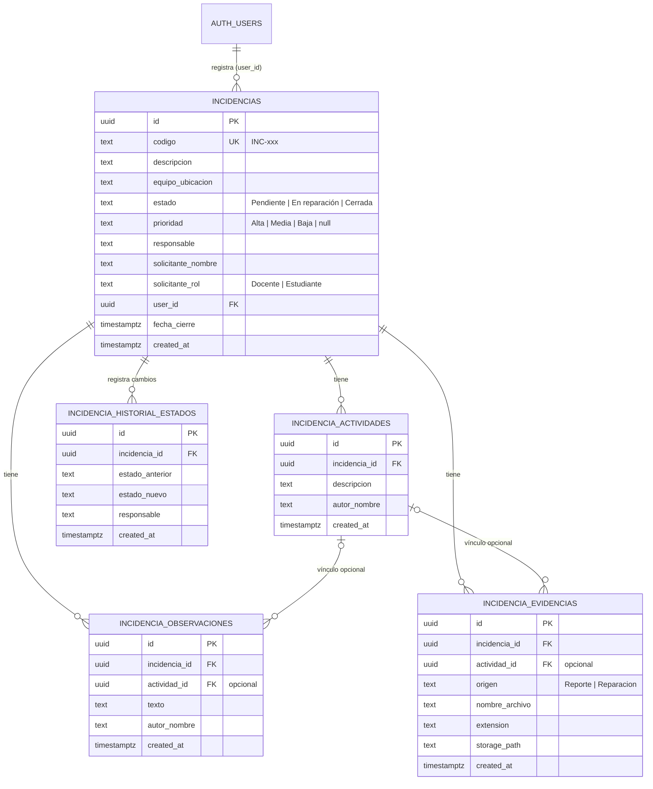

# Base de datos del Módulo 6 · PostgreSQL / Supabase

Documento basado en `supabase/02_modulo6_incidencias.sql`, `supabase/03_modulo6_seed_pruebas.sql`, `src/modules/incidencias/incidenciasService.js` y `src/lib/supabase.js`. Todos los ejemplos usan datos ficticios.

## 1. Resumen del modelo relacional

Cinco tablas. `incidencias` es la entidad central; las otras cuatro dependen de ella (`ON DELETE CASCADE`). `auth.users` es la tabla de usuarios de Supabase Auth.



Cardinalidades: una incidencia tiene 0..N actividades, observaciones, evidencias y cambios de estado. Una observación o evidencia puede vincularse a 0..1 actividad de la **misma** incidencia.

## 2. Diccionario de tablas

### `incidencias`

| Columna | Tipo | NOT NULL | DEFAULT | Restricciones | Qué almacena |
|---|---|---|---|---|---|
| id | uuid | sí | `gen_random_uuid()` | PK | Identificador interno |
| codigo | text | sí | `'INC-' + nextval(incidencias_codigo_seq)` (desde 101) | UNIQUE | Código legible (HU-07 CA-01) |
| descripcion | text | sí | — | CHECK 1–1000 caracteres sin espacios vacíos | Problema reportado |
| equipo_ubicacion | text | sí | — | CHECK 1–200 caracteres | Equipo o lugar afectado |
| estado | text | sí | `'Pendiente'` | CHECK en (Pendiente, En reparación, Cerrada) | Estado actual |
| prioridad | text | no | null | CHECK en (Alta, Media, Baja) | Prioridad (HU-01) |
| responsable | text | no | null | CHECK longitud; **CHECK responsable ⇒ prioridad** | Personal asignado |
| solicitante_nombre | text | sí | — | CHECK 1–120 caracteres | Quien reportó (HU-07 CA-04) |
| solicitante_rol | text | sí | — | CHECK en (Docente, Estudiante) | Rol del solicitante |
| actualizado_por | text | no | — | — | Perfil que hizo el último cambio (alimenta el historial) |
| estado_actualizado_at | timestamptz | no | — | lo llena un trigger | Fecha/hora del último cambio de estado |
| fecha_cierre | timestamptz | no | — | lo llena un trigger; CHECK Cerrada ⇒ fecha | Cierre (HU-05 CA-02) |
| user_id | uuid | sí | `auth.uid()` | FK → auth.users | Cuenta que registró |
| created_at | timestamptz | sí | `now()` | — | Fecha/hora del reporte |
| updated_at | timestamptz | sí | `now()` | lo actualiza un trigger | Última modificación |

Restricciones de tabla: `responsable IS NULL OR prioridad IS NOT NULL`, `estado = 'Pendiente' OR responsable IS NOT NULL`, `estado <> 'Cerrada' OR fecha_cierre IS NOT NULL`.

### `incidencia_actividades`

| Columna | Tipo | NOT NULL | DEFAULT | Restricciones | Qué almacena |
|---|---|---|---|---|---|
| id | uuid | sí | `gen_random_uuid()` | PK | Identificador |
| incidencia_id | uuid | sí | — | FK → incidencias (cascade) | Incidencia reparada |
| descripcion | text | sí | — | CHECK 1–1000 caracteres | Acción realizada (HU-03) |
| autor_nombre | text | sí | — | CHECK 1–120 | Ej. Pasante 1 |
| autor_rol | text | sí | — | CHECK en (Coordinador técnico, Técnico de soporte, Pasante) | Rol del autor |
| user_id | uuid | sí | `auth.uid()` | FK → auth.users | Cuenta que registró |
| created_at | timestamptz | sí | `now()` | — | Fecha y hora automáticas |

### `incidencia_observaciones`

| Columna | Tipo | NOT NULL | DEFAULT | Restricciones | Qué almacena |
|---|---|---|---|---|---|
| id | uuid | sí | `gen_random_uuid()` | PK | Identificador |
| incidencia_id | uuid | sí | — | FK → incidencias (cascade) | Incidencia |
| actividad_id | uuid | no | null | FK → incidencia_actividades (set null); trigger: misma incidencia | Vínculo opcional (HU-04 CA-01) |
| texto | text | sí | — | CHECK 1–1000 | Observación / solución |
| autor_nombre, autor_rol | text | sí | — | CHECK | Autor |
| user_id | uuid | sí | `auth.uid()` | FK | Cuenta |
| created_at | timestamptz | sí | `now()` | — | Fecha y hora |

### `incidencia_evidencias`

| Columna | Tipo | NOT NULL | DEFAULT | Restricciones | Qué almacena |
|---|---|---|---|---|---|
| id | uuid | sí | `gen_random_uuid()` | PK | Identificador |
| incidencia_id | uuid | sí | — | FK (cascade) | Incidencia |
| actividad_id | uuid | no | null | FK opcional; trigger: misma incidencia | Vínculo opcional |
| origen | text | sí | — | CHECK en (Reporte, Reparacion) | Adjunta al reportar (HU-07) o al reparar (HU-04) |
| nombre_archivo | text | sí | — | CHECK 1–255 | Nombre original |
| extension | text | sí | — | CHECK en (jpg, jpeg, png, pdf) | Formato permitido (HU-04 CA-02/03) |
| mime_type | text | no | — | CHECK en (image/jpeg, image/png, application/pdf) | Tipo informado por el navegador |
| tamano_bytes | bigint | no | — | CHECK 1–5 242 880 (5 MB) | Tamaño |
| storage_path | text | no | — | — | Ruta en Supabase Storage (null si solo hay metadatos) |
| autor_nombre, autor_rol | text | sí | — | CHECK (incluye Docente y Estudiante) | Autor |
| user_id | uuid | sí | `auth.uid()` | FK | Cuenta |
| created_at | timestamptz | sí | `now()` | — | Fecha y hora |

### `incidencia_historial_estados`

| Columna | Tipo | NOT NULL | DEFAULT | Restricciones | Qué almacena |
|---|---|---|---|---|---|
| id | uuid | sí | `gen_random_uuid()` | PK | Identificador |
| incidencia_id | uuid | sí | — | FK (cascade) | Incidencia |
| estado_anterior | text | no | — | CHECK de estados; null en el registro inicial | Estado previo |
| estado_nuevo | text | sí | — | CHECK de estados | Estado nuevo |
| responsable | text | sí | — | — | Perfil que hizo el cambio |
| user_id | uuid | no | — | FK (set null) | Cuenta que hizo el cambio |
| created_at | timestamptz | sí | `clock_timestamp()` | — | Momento exacto del cambio |

### Reglas de negocio que garantiza PostgreSQL (aunque se salte la interfaz)

| Regla | Mecanismo | HU |
|---|---|---|
| No asignar responsable sin prioridad | `CHECK (responsable IS NULL OR prioridad IS NOT NULL)` | HU-01 CA-04 |
| Valores válidos de estado, prioridad y rol | CHECK de lista | HU-01, HU-05, HU-07 |
| Código único INC-xxx | DEFAULT con secuencia + UNIQUE | HU-07 CA-01 |
| Toda incidencia nueva nace «Pendiente» | DEFAULT + trigger `incidencias_antes_de_guardar` | HU-07 CA-01 |
| Solicitante, cuenta y fecha automáticos | DEFAULT `auth.uid()`, `now()` + RLS `WITH CHECK` | HU-07 CA-04 |
| No cerrar sin solución registrada | trigger: exige observación o evidencia de reparación | HU-05 CA-03 |
| Solo se cierra desde «En reparación»; una cerrada no se reabre | trigger | HU-05 CA-02 |
| Fecha de cambio y de cierre automáticas | trigger (`estado_actualizado_at`, `fecha_cierre`) | HU-05 CA-01/02 |
| Historial de estados automático e infalsificable | trigger `SECURITY DEFINER`; el rol web no tiene INSERT | HU-05 CA-04 |
| No registrar actividades en incidencias cerradas | trigger `actividades_validar_incidencia` | HU-03 CA-04 |
| Descripción/observación no vacía | `CHECK (char_length(trim(...)) > 0)` | HU-03 CA-02, HU-07 CA-02 |
| Solo jpg/jpeg/png/pdf de hasta 5 MB | CHECK de `extension`, `mime_type`, `tamano_bytes` | HU-04 CA-02/03 |

## 3. Trazabilidad: acción en la interfaz → operación en la base de datos

| Acción (HU) | Tabla(s) | SQL | Campos que envía React | Campos automáticos |
|---|---|---|---|---|
| Registrar incidencia (HU-07) | incidencias → historial | INSERT | descripcion, equipo_ubicacion, solicitante_nombre, solicitante_rol, user_id | id, codigo, estado = Pendiente, created_at, updated_at; el trigger inserta en el historial `null → Pendiente` |
| Adjuntar evidencia al reportar (HU-07 CA-03) | incidencia_evidencias (+ Storage opcional) | INSERT | nombre_archivo, extension, mime_type, tamano_bytes, origen = Reporte, autor | id, created_at, storage_path si el bucket existe |
| Listar / ordenar / filtrar (HU-01, HU-02, HU-06) | incidencias | SELECT | — | El orden por prioridad y la carga se calculan en React |
| Asignar prioridad (HU-01 CA-01) | incidencias | UPDATE | prioridad, actualizado_por | updated_at |
| Asignar responsable (HU-01 CA-02) | incidencias | UPDATE | responsable, actualizado_por | updated_at; CHECK exige prioridad |
| Registrar actividad (HU-03) | incidencia_actividades | INSERT | incidencia_id, descripcion, autor_nombre, autor_rol, user_id | id, created_at; el trigger valida que no esté Cerrada |
| Agregar observación (HU-04) | incidencia_observaciones | INSERT | incidencia_id, texto, actividad_id (opcional), autor | id, created_at |
| Adjuntar evidencia (HU-04) | incidencia_evidencias (+ Storage) | INSERT | como arriba, origen = Reparacion | id, created_at |
| Pasar a En reparación (HU-05 CA-01) | incidencias → historial | UPDATE | estado, actualizado_por | estado_actualizado_at, updated_at, fila de historial |
| Cerrar (HU-05 CA-02/03) | incidencias → historial | UPDATE | estado = Cerrada, actualizado_por | fecha_cierre, estado_actualizado_at, fila de historial; el trigger rechaza si no hay solución |
| Ver detalle (HU-03/04/05) | actividades, observaciones, evidencias, historial | SELECT | incidencia_id | — |

## 4. Seguridad: GRANT y políticas RLS

### GRANT (por qué evitan el error 42501)

En Supabase, una tabla creada por SQL no es accesible para el rol `authenticated` hasta que se le dan permisos. Sin GRANT, PostgreSQL responde **42501 permission denied** antes de evaluar RLS. El script da solo lo mínimo:

| Objeto | Permiso para `authenticated` | Motivo |
|---|---|---|
| incidencias | SELECT; INSERT solo de `descripcion, equipo_ubicacion, solicitante_nombre, solicitante_rol, actualizado_por, user_id`; UPDATE solo de `prioridad, responsable, estado, actualizado_por` | Nadie puede escribir `codigo`, `created_at` ni `fecha_cierre` desde el navegador |
| actividades, observaciones, evidencias | SELECT, INSERT | Agregar y consultar; sin UPDATE ni DELETE |
| historial_estados | SELECT | Solo lo escribe el trigger |
| incidencias_codigo_seq | USAGE, SELECT | El DEFAULT del código llama a `nextval()` |
| `anon` | REVOKE ALL | Sin sesión no hay acceso |

### Políticas RLS (RLS activado en las 5 tablas)

| Política | Tabla | Operación | Cláusula | Qué garantiza |
|---|---|---|---|---|
| `incidencias_select_autenticados` | incidencias | SELECT | `USING (true)` para `authenticated` | El personal autenticado ve todas las incidencias (el módulo es colaborativo) |
| `incidencias_insert_propias` | incidencias | INSERT | `WITH CHECK (auth.uid() = user_id)` | Nadie registra a nombre de otra cuenta |
| `incidencias_update_autenticados` | incidencias | UPDATE | `USING/WITH CHECK (auth.uid() IS NOT NULL)` | Solo con sesión; las columnas editables están limitadas por GRANT |
| `*_select_autenticados` | actividades, observaciones, evidencias, historial | SELECT | `USING (true)` | Lectura para el personal autenticado |
| `*_insert_propias` | actividades, observaciones, evidencias | INSERT | `WITH CHECK (auth.uid() = user_id)` | Cada registro queda firmado por la cuenta real |
| (ninguna) | todas | DELETE | — | No se puede borrar nada desde la app |

La app usa solo la **Publishable key** con la sesión del usuario. No se usa `service_role` ni claves secretas: toda operación pasa por GRANT + RLS.

Limitación conocida: los perfiles operativos (coordinador, técnico, pasante) se simulan en React para la demostración. RLS distingue «con sesión / sin sesión» y «registro propio», no el rol operativo. Para producción habría que agregar una tabla de perfiles por usuario y usarla en las políticas.

## 5. Guía de montaje y verificación en Supabase

### Orden de ejecución (Supabase → SQL Editor → New query)

1. `supabase/01_base_demo.sql` (ejemplo docente, si aún no existe).
2. `supabase/02_modulo6_incidencias.sql` → debe responder «Success. No rows returned».
3. Crear una cuenta de prueba desde la app (pantalla de acceso).
4. (Opcional) `supabase/03_modulo6_seed_pruebas.sql` → muestra la lista de códigos creados.
5. (Opcional) Descomentar la sección 6 de `02_…sql` para crear el bucket `evidencias-incidencias` de Storage.

### Qué revisar en Table Editor

Después de una prueba en React y de recargar la página (F5):
- `incidencias`: la fila nueva con `codigo`, `estado = Pendiente`, `user_id` y `created_at` llenos.
- `incidencia_historial_estados`: una fila por cada registro y por cada cambio de estado.
- `incidencia_actividades`, `incidencia_observaciones`, `incidencia_evidencias`: las filas con su `incidencia_id`.
- En cada tabla, el ícono de RLS debe indicar políticas activas.

### Consultas de verificación (copiar en SQL Editor)

```sql
-- 1) Incidencias ordenadas por prioridad (Alta → Media → Baja → sin prioridad)
select codigo, descripcion, estado, prioridad, responsable, created_at
from public.incidencias
order by case prioridad when 'Alta' then 1 when 'Media' then 2 when 'Baja' then 3 else 4 end, created_at;
```

```sql
-- 2) Actividades, observaciones y evidencias de una incidencia
select 'Actividad' as tipo, a.descripcion as detalle, a.autor_nombre, a.created_at
from public.incidencia_actividades a join public.incidencias i on i.id = a.incidencia_id where i.codigo = 'INC-032'
union all
select 'Observación', o.texto, o.autor_nombre, o.created_at
from public.incidencia_observaciones o join public.incidencias i on i.id = o.incidencia_id where i.codigo = 'INC-032'
union all
select 'Evidencia', e.nombre_archivo || ' (' || e.origen || ')', e.autor_nombre, e.created_at
from public.incidencia_evidencias e join public.incidencias i on i.id = e.incidencia_id where i.codigo = 'INC-032'
order by created_at;
```

```sql
-- 3) Historial cronológico de estados de una incidencia
select i.codigo, h.estado_anterior, h.estado_nuevo, h.responsable, h.created_at
from public.incidencia_historial_estados h join public.incidencias i on i.id = h.incidencia_id
where i.codigo = 'INC-043'
order by h.created_at;
```

```sql
-- 4) Carga activa por responsable (sin cerradas) y sobrecarga con L = 3
select responsable,
       count(*) filter (where estado <> 'Cerrada') as activas,
       count(*) filter (where estado = 'Cerrada')  as cerradas,
       count(*) filter (where estado <> 'Cerrada') > 3 as sobrecargado
from public.incidencias
where responsable is not null
group by responsable
order by activas desc;
```

```sql
-- 5) RLS activo y políticas del módulo
select c.relname as tabla, c.relrowsecurity as rls_activo,
       p.policyname, p.cmd, p.roles, p.qual as using_expr, p.with_check
from pg_class c
join pg_namespace n on n.oid = c.relnamespace and n.nspname = 'public'
left join pg_policies p on p.schemaname = 'public' and p.tablename = c.relname
where c.relname like 'incidencia%'
order by c.relname, p.policyname;
```

## 6. Errores comunes y diagnóstico rápido

| Síntoma | Causa probable | Qué revisar |
|---|---|---|
| El módulo pide iniciar sesión | No hay sesión de Supabase | Ingresar con la cuenta de prueba; confirmar el correo si Supabase lo exige |
| «Configuración pendiente» / «Modo sin conexión» | `.env` ausente o mal escrito | `.env` en la raíz con `VITE_SUPABASE_URL` y `VITE_SUPABASE_PUBLISHABLE_KEY`; reiniciar `npm run dev` |
| `permission denied` (42501) | Faltan GRANT o se envió una columna no permitida | Volver a ejecutar `02_…sql`; no enviar `codigo`, `estado` ni fechas en el INSERT |
| `new row violates row-level security policy` | `user_id` distinto de la sesión o sin sesión | Que el INSERT use `session.user.id`; revisar la consulta 5 |
| `violates check constraint` (23514) | Dato fuera de lo permitido (ej. responsable sin prioridad, extensión no válida) | Leer el nombre de la restricción en el mensaje; corregir el dato |
| `relation "incidencias" does not exist` (42P01) | No se ejecutó el script del módulo o es otro proyecto | Ejecutar `02_…sql` en el proyecto cuya URL está en `.env` |
| Mensaje del trigger (P0001), ej. «Debe registrar la solución aplicada…» | Regla de negocio | Es el comportamiento esperado; registrar la solución y reintentar |
| El seed falla con «Primero crea una cuenta de prueba» | `auth.users` vacío | Crear una cuenta desde la app y volver a ejecutar el seed |
| La evidencia muestra «solo metadatos» | No existe el bucket de Storage | Es válido; para subir archivos, ejecutar la sección 6 opcional |
